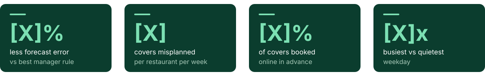
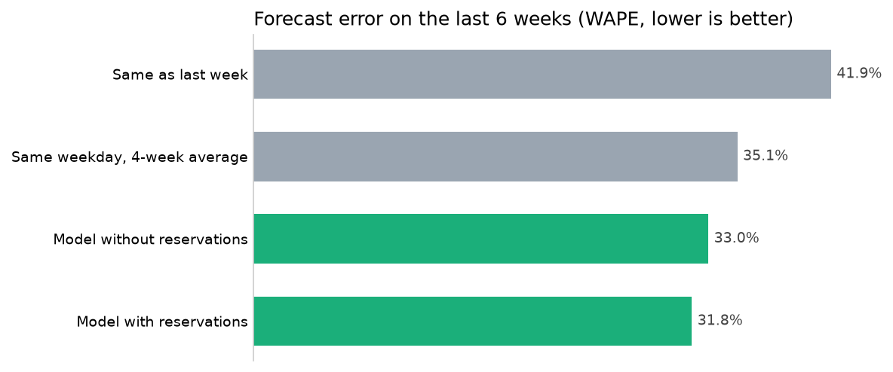
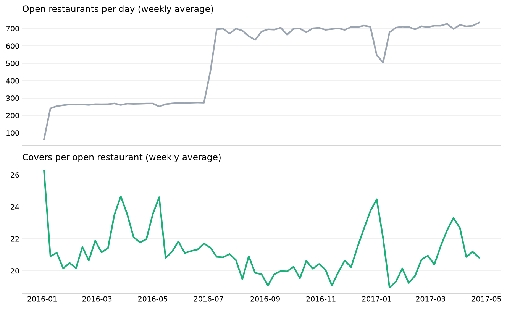
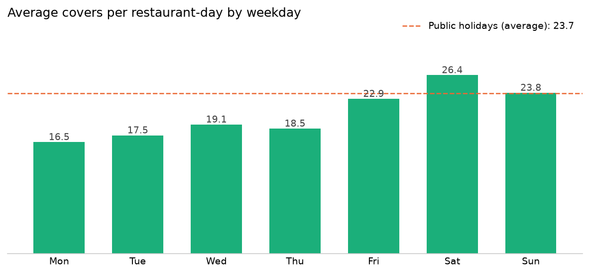
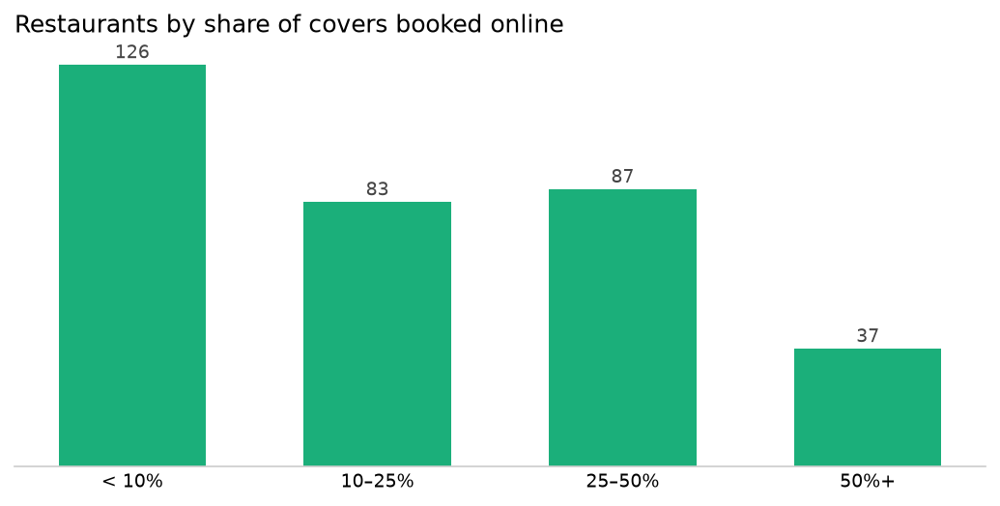
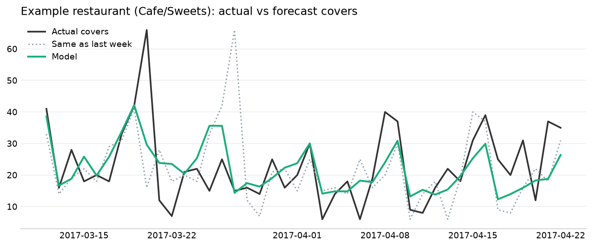
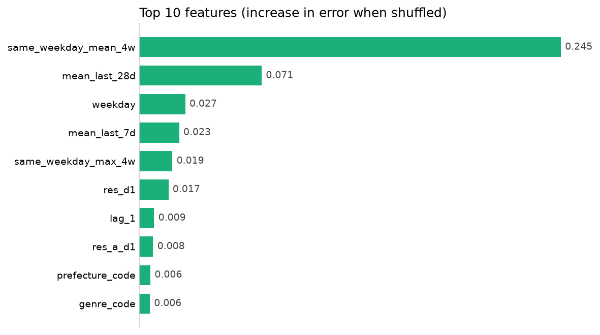
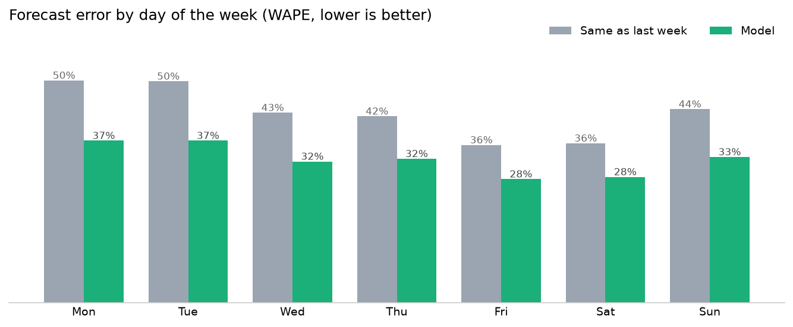

[](images/banner.svg)


[Background](#project-background) · [Key Metrics](#key-metrics) · [Summary](#executive-summary) · [Insights](#insights-deep-dive) · [Recommendations](#recommendations) · [Repository](#repository-and-how-to-run)

> Daily forecasts of covers for **829 restaurants**, from 16 months of point-of-sale data and online reservations. Demand is volatile (63% of restaurants move by more than half of their average day) and only **~21%** of covers are booked online. A gradient boosting model brings the forecast error from **41.9%** ("same as last week") to **31.8%**, cutting the covers misplanned per restaurant per week by **24%** and the food prepared and not served by **45%**.

<a id="project-background"></a>
[](images/h_background.svg)

Every evening a restaurant decides how much to prepare and how many people to schedule for the next day. Too much means food thrown away and idle staff; too little means dishes running out and guests waiting. Most kitchens plan on intuition or on "same as last week".

This project uses daily covers from a point-of-sale system and reservations from two online booking platforms to answer four questions:

1. How does demand change over time, across the week and on holidays?
2. How much of a restaurant's demand is visible in advance through online reservations?
3. How accurately can tomorrow's covers be forecast, and how much better than simple rules?
4. What does a better forecast mean in covers, and when should a manager not trust it?

<a id="key-metrics"></a>
[](images/h_metrics.svg)

[](images/kpi_cards.svg)

<a id="executive-summary"></a>
[](images/h_summary.svg)

[](figures/model_comparison.png)

| Forecast (last 6 weeks, never used for training) | WAPE | Avg error (covers) | Bias |
|---|---|---|---|
| *Same as last week* | *41.9%* | *9.25* | *+0.1%* |
| *Same weekday, 4-week average* | *35.1%* | *7.75* | *−0.2%* |
| Model without reservations | 33.0% | 7.28 | −10.8% |
| **Model with reservations (final)** | **31.8%** | **7.02** | **−8.9%** |

*WAPE = total absolute error ÷ total covers ("10%" = off by 10 covers for every 100 served). Bias > 0 = over-forecast.*

**What this means**

- **24% fewer covers misplanned** than planning on "same as last week": from 56.1 to 42.5 covers per restaurant per week, and −9.4% compared with the best simple rule (4-week weekday average).
- **Almost half of the over-preparation disappears** (over-forecast covers −45%), but shortages barely change: the model under-forecasts by ~9%, a bias to correct before use.
- **Online reservations help, but they are not the forecast:** they reduce the error from 35.0% to 32.2% where they exist, yet they cover only ~21% of covers.
- **Holidays, Mondays, small restaurants and one-off events** remain the hardest days to plan.

<a id="insights-deep-dive"></a>
[](images/h_insights.svg)

### 1. Totals mislead: covers per open restaurant
[Notebook 02](notebooks/02_demand_patterns.ipynb)

[](figures/covers_over_time.png)

Restaurants start reporting at different dates, so total covers jump when new restaurants join, without any change in demand. All comparisons use **covers per open restaurant**. A typical restaurant serves **17 covers a day** (mean 21.0) and is open on 85.9% of days.

### 2. The week sets the rhythm
[Notebook 02](notebooks/02_demand_patterns.ipynb)

[](figures/covers_by_weekday.png)

Saturday averages **26.4** covers per restaurant vs **16.5** on Monday (**1.6x**); public holidays (23.7) look like a weekend day. Around this rhythm, daily demand is **volatile**: the median restaurant has a coefficient of variation of **0.55**, and **63%** of restaurants move by more than half of their average day.

### 3. Online reservations show only part of the demand
[Notebook 02](notebooks/02_demand_patterns.ipynb)

[](figures/reservation_share.png)

333 of the 829 restaurants receive online reservations. In those restaurants, **20.8%** of covers are booked online and **16.8%** are known the day before (reservations made on the day itself would be information from the future and are not used). **126 of 333** restaurants get less than 10% of covers online, and the median correlation between reservations and covers is **0.33**: the rest is walk-ins and phone bookings.

### 4. Forecasting tomorrow's covers
[Notebook 03](notebooks/03_forecasting_model.ipynb)

[](figures/example_restaurant.png)

[](figures/feature_importance.png)

The model is trained on all days up to 6 weeks before the end of the data and evaluated on the last 6 weeks. The best simple rule ("same weekday, 4-week average", 35.1% WAPE) is already much better than "same as last week" (41.9%); the model reaches **31.8%**. Recent history drives the forecast (4-week weekday average, 28-day and 7-day averages, weekday). Reservations add **2.8 points** of accuracy for restaurants that receive them.

**The model is cautious:** trained on log(1 + covers), it predicts closer to a typical day than to the average day, and under-forecasts total covers by **8.9%**. A scaling correction or a Poisson loss is the next step.

### 5. Where the forecast is reliable, and where it is not
[Notebook 04](notebooks/04_business_impact.ipynb)

[](figures/error_by_weekday.png)

| Compared with "same as last week" | Last week rule | Model |
|---|---|---|
| Average error per restaurant-day | 9.25 covers | **7.02 covers** |
| Covers misplanned per restaurant per week | 56.1 | **42.5** (−24%) |
| Covers prepared and not served (6 weeks, all restaurants) | 139,129 | **75,789** (−45%) |
| Covers missing (under-forecast) | 138,569 | 135,003 (−3%) |

| Where the model struggles | WAPE |
|---|---|
| Mondays vs Fridays | 36.6% vs 27.9% |
| Public holidays vs normal days | 38.0% vs 31.7% (bias −13.9%) |
| Smallest vs largest 25% of restaurants | 42.8% vs 27.4% (but 3.7 vs 10.7 covers a day) |
| One-off events (10 days > 10x the restaurant's median) | ~90% |

Small restaurants have the highest error in percentage but the smallest in covers: one table more or less is a large share of a quiet day.

**Technical details**

```
POS covers + 2 reservation feeds ──► cleaning & D-1 reservations ──► demand patterns ──► features & model ──► error in covers
        (6 files)                       (notebook 01)                  (notebook 02)       (notebook 03)       (notebook 04)
```

- **No information from the future:** every feature uses only days before the forecast day; reservations count only if made before the visit day.
- **Closed days:** a day without a record is treated as closed: it is not forecast or evaluated.
- **Changing number of restaurants:** demand is compared per open restaurant, not in totals.
- **Validation:** the last 6 weeks are held out; the model is compared with "same as last week" and "same weekday, 4-week average".
- **Model:** gradient boosting (`HistGradientBoostingRegressor`) on log(1 + covers), with lags, weekday averages, holidays, cuisine, area and reservations known the day before. Trained with and without reservations to measure their value.
- **Metrics a kitchen understands:** WAPE, average error in covers, over- and under-forecast covers, bias.

<a id="recommendations"></a>
[](images/h_reco.svg)

1. **Plan prep and staff on the forecast rather than on "last week":** 24% fewer covers misplanned and almost half of the food prepared and not served.
2. **Correct the bias before use.** The model under-forecasts by ~9% (~14% on holidays): apply a scaling correction or a Poisson loss, or add a safety margin on items that keep.
3. **Feed online reservations into the forecast, never use them as the forecast.** They improve accuracy where available, but cover only about one fifth of demand.
4. **Keep a manual check for events, holidays and Mondays,** where history says least about tomorrow. Events booked in advance (private parties, groups) should be entered by hand.

**Limitations:** restaurants in one country over 16 months; no information on menus, prices, weather or local events; closed days are inferred from missing records; the validation period does not include the longest holiday weeks.

<a id="repository-and-how-to-run"></a>
[](images/h_repo.svg)

```
Restaurant_Demand_Forecasting/
├── data/
│   ├── raw/                            # 6 CSV files from Kaggle (not in the repo)
│   └── processed/                      # daily table and predictions (created by the notebooks)
├── notebooks/
│   ├── 01_data_cleaning.ipynb          # quality checks, reservations known the day before
│   ├── 02_demand_patterns.ipynb        # trends, weekdays, holidays, online share
│   ├── 03_forecasting_model.ipynb      # baselines, gradient boosting, value of reservations
│   └── 04_business_impact.ipynb        # error in covers, by weekday, size and segment
├── figures/                            # charts exported by the notebooks
├── images/                             # README banners
├── requirements.txt
└── README.md
```

```bash
git clone https://github.com/AlessandroCucchi/Restaurant_Demand_Forecasting.git
cd Restaurant_Demand_Forecasting
python -m venv .venv
source .venv/bin/activate          # Windows: .venv\Scripts\activate
pip install -r requirements.txt
# download the competition files and extract the 6 CSVs into data/raw/
jupyter notebook                    # run notebooks 01 to 04 in order
```

**Data:** [Recruit Restaurant Visitor Forecasting](https://www.kaggle.com/c/recruit-restaurant-visitor-forecasting) (Kaggle, 2017): daily covers of restaurants in Japan from January 2016 to April 2017 and reservations from two booking platforms. Files used: `air_visit_data.csv`, `air_reserve.csv`, `hpg_reserve.csv`, `store_id_relation.csv`, `air_store_info.csv`, `date_info.csv`. Please check the competition's terms of use before reusing the data.

## Author

**Alessandro Cucchi**

[](https://www.linkedin.com/in/YOUR-LINKEDIN)
[](https://github.com/AlessandroCucchi)
